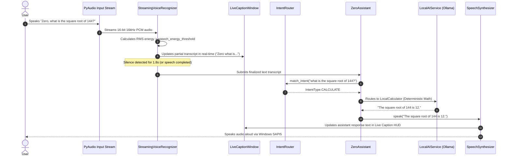
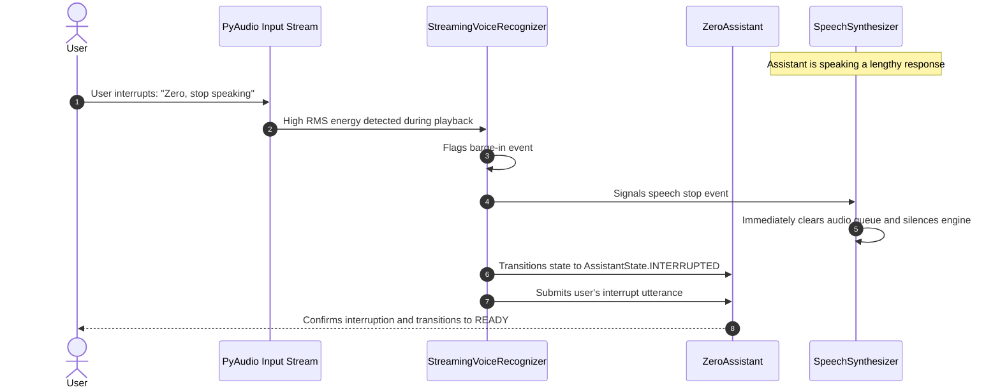

# Zero AI — Complete System Architecture & Engineering Reference

Zero is a personal AI desktop assistant engineered with a modular, decoupled Python architecture, a native PySide6 graphical interface (JARVIS aesthetic), a floating Live Caption HUD, and a 100% local-first AI runtime powered by Ollama.

---

## 1. High-Level Architectural Diagram

```mermaid
flowchart TB
    subgraph UI ["Desktop User Interface (PySide6)"]
        MW["MainWindow (JARVIS Theme)"]
        Orb["AIOrbWidget (Reactive Vector Animation)"]
        Chat["ChatPanelWidget (Transcripts & Controls)"]
        HUD["LiveCaptionWindow (Floating Transparent HUD)"]
    end

    subgraph AudioPipeline ["Real-Time Voice Pipeline"]
        Mic["Microphone (PyAudio PCM Stream)"]
        VAD["StreamingVoiceRecognizer (Dynamic RMS Energy VAD)"]
        BargeIn["Barge-In Interruption Detector"]
        TTS["SpeechSynthesizer (Windows SAPI5 STA Thread)"]
    end

    subgraph CoreEngine ["Core Orchestration & Controllers"]
        Router["IntentRouter (Pattern Matching & Priority)"]
        State["StateManager (Thread-Safe AssistantState FSM)"]
        Assistant["ZeroAssistant (Central Orchestrator)"]
        Calc["LocalCalculator (Safe Deterministic Math)"]
    end

    subgraph AIInference ["Local AI Subsystem (Ollama HTTP 127.0.0.1:11434)"]
        LocalAI["LocalAIService (Model Routing Engine)"]
        Llama["Llama 3.2 3B (General Assistant & Conversationalist)"]
        Qwen["Qwen 2.5 Coder 7B (Code, SQL, Debugging, Architecture)"]
    end

    subgraph RAG ["Knowledge Retrieval Subsystem"]
        KFiles["Knowledge/ Reference Documents (.pdf, .docx, .txt)"]
        KService["KnowledgeService (SHA-256 Deduplication & Parser)"]
        KFTS["SQLite FTS5 Full-Text Index & BM25 Scoring"]
    end

    subgraph ToolsSubsystem ["Approved Desktop Tools & Diagnostics"]
        ToolReg["ActionRegistry (Security Allowlist Enforcement)"]
        Desktop["DesktopControlService (Window Management, App Launcher)"]
        NetDiag["NetworkDiagnostics (DNS, Ping, Interfaces, Sockets)"]
        SysDiag["SystemDiagnostics (CPU, RAM, Disks, Telemetry)"]
        PDFGen["PDFGenerator (HTML Report & Playwright Chromium PDF)"]
    end

    subgraph Persistence ["Persistence & Database Layer"]
        DB["SQLite Engine (data/zero.db) via SQLAlchemy ORM"]
        CStore["ConversationStore (Chat History & Session Context)"]
        AStore["ActivityStore (Audit Log of All Assistant Actions)"]
    end

    subgraph API ["Local Loopback API (FastAPI 127.0.0.1:8765)"]
        FastAPI["Uvicorn Background Daemon Server"]
    end

    %% UI to Core
    MW --> Assistant
    Chat --> Assistant
    Assistant --> State
    Assistant --> Router

    %% Voice connections
    Mic --> VAD
    VAD --> HUD
    VAD --> BargeIn
    BargeIn -->|Stop Audio| TTS
    VAD -->|Finalized Utterance| Assistant
    Assistant -->|Spoken Response| TTS
    TTS --> HUD

    %% Core to Subsystems
    Assistant --> Calc
    Assistant --> LocalAI
    Assistant --> ToolReg
    Assistant --> KService

    %% AI Subsystem
    LocalAI -->|Chat Query| Llama
    LocalAI -->|Coding Query| Qwen

    %% RAG connections
    KFiles --> KService
    KService --> KFTS
    LocalAI -->|Augmented Grounding| KFTS

    %% Tool connections
    ToolReg --> Desktop
    ToolReg --> NetDiag
    ToolReg --> SysDiag
    Assistant --> PDFGen

    %% Persistence
    Assistant --> CStore
    Assistant --> AStore
    CStore --> DB
    AStore --> DB
    FastAPI --> Assistant
```

---

## 2. Directory Structure & Module Responsibilities

```text
ZERO/
├── app/
│   ├── __init__.py           # Subsystem package root metadata and versioning
│   ├── bootstrap.py          # Unified application bootstrap and hardware discovery
│   ├── main.py               # GUI mode entry point runner
│   ├── ai/                   # Local AI abstraction, Ollama routing, and connectivity tests
│   │   ├── base.py           # BaseAIProvider abstract interface
│   │   ├── connection_tester.py # Ollama health, ping, and benchmark tester
│   │   ├── local_service.py  # LocalAIService (Ollama client, dual-model router)
│   │   ├── provider_factory.py # Factory resolving LocalAIService or DemoProvider
│   │   └── providers/        # Demo and fallback cloud providers
│   ├── api/                  # Isolated loopback REST API server (FastAPI 127.0.0.1:8765)
│   │   ├── server.py         # FastAPI application factory and background uvicorn manager
│   │   └── routes/           # REST endpoints for health, chat, briefings, knowledge, artifacts
│   ├── config/               # Application configuration and structured logging
│   │   ├── settings.py       # Pydantic Settings loaded from .env with validation
│   │   └── logging_config.py # Rotating file and console logging setup
│   ├── controllers/          # Canonical controller facade re-exporting assistant components
│   ├── core/                 # Central assistant engine and business logic
│   │   ├── assistant.py      # ZeroAssistant: central coordinator and request handler
│   │   ├── briefing_service.py # Timezone-aware daily briefing generator
│   │   ├── calculator.py     # Deterministic arithmetic calculator using Python ast
│   │   ├── conversation_manager.py # Prompt assembly and dialogue memory tracking
│   │   ├── intent_router.py  # Regex and token-based intent matcher
│   │   └── state_manager.py  # Thread-safe finite state machine (AssistantState)
│   ├── database/             # Canonical database facade re-exporting engine and models
│   ├── exports/              # Document compilation and verified PDF artifact generation
│   │   └── pdf_generator.py  # Clean HTML report compiler and Playwright PDF renderer
│   ├── gui/                  # PySide6 desktop graphical interface
│   │   ├── main_window.py    # Main desktop HUD window with sidebar and view switcher
│   │   ├── theme.py          # Dark cyberpunk/JARVIS neon stylesheet (DARK_THEME_QSS)
│   │   └── widgets/          # Individual modular UI panels and widgets
│   │       ├── ai_orb.py     # Reactive vector-painted glowing orbital widget
│   │       ├── caption_window.py # Floating semi-transparent Live Caption HUD
│   │       ├── command_center.py # Stitch Screen 1: Command Center with dynamic AI Orb and telemetry
│   │       ├── transcript_panel.py # Stitch Screen 2: Live Voice Transcript & Code Intelligence workspace
│   │       ├── system_control_panel.py # Stitch Screen 3: System Control & Windows Registry Bento Grid
│   │       ├── footer_voice_bar.py # Persistent 40px audio dock with live equalizer and controls
│   │       ├── chat_panel.py # Main interaction panel with chat bubbles and controls
│   │       ├── briefing_panel.py # Briefing and agenda dashboard
│   │       ├── history_panel.py # Conversation search and memory explorer
│   │       ├── knowledge_panel.py # Knowledge ingestion status and search view
│   │       ├── settings_panel.py # Assistant configuration preferences
│   │       ├── sidebar.py    # 64px slim navigation rail with operator avatar and module shortcuts
│   │       ├── status_bar.py # Real-time subsystem health indicator
│   │       └── system_panel.py # System hardware and process monitoring view
│   ├── knowledge/            # Local RAG knowledge base subsystem
│   │   ├── chunker.py        # Token-aware sliding window text chunker
│   │   ├── parsers.py        # Multi-format document parser (PDF, DOCX, PPTX, XLSX, TXT)
│   │   ├── service.py        # Knowledge ingestion coordinator with SHA-256 deduplication
│   │   └── store.py          # SQLite FTS5 database engine with BM25 keyword ranking
│   ├── memory/               # Persistence, ORM models, and activity repositories
│   │   ├── database.py       # SQLAlchemy engine, sessionmaker, and transactional scopes
│   │   ├── models.py         # SQLAlchemy ORM entity models (Conversations, Messages, Activities)
│   │   ├── conversation_store.py # High-level conversation query repository
│   │   └── activity_store.py # Audited event recording repository
│   ├── models/               # Canonical schemas and database models facade
│   ├── services/             # High-level services facade
│   │   └── desktop_control.py # Windows automation, window states, process management
│   ├── system/               # System health and hardware diagnostic probes
│   │   └── health_monitor.py # Periodic health probes for AI, DB, Voice, and host metrics
│   ├── tools/                # Approved security-allowlisted tools
│   │   ├── registry.py       # ActionRegistry with strict allowlisting and schema checks
│   │   ├── browser_tools.py  # Safe browser URL opening and web search execution
│   │   ├── desktop_tools.py  # Window focus, minimize, maximize, and app launching tools
│   │   ├── network_diagnostics.py # DNS resolution, ping, interface discovery, socket testing
│   │   └── system_diagnostics.py # System hardware telemetry tools
│   ├── ui/                   # Canonical UI facade re-exporting MainWindow and HUD
│   ├── utils/                # Cross-cutting utility functions
│   │   ├── paths.py          # Project directory isolation and path resolver
│   │   └── time_utils.py     # Timezone-aware greetings and timestamp formatting
│   └── voice/                # Real-time audio streaming, VAD, and speech synthesis
│       ├── manager.py        # High-level VoiceManager coordinating listener and synthesizer
│       ├── speech_recognition.py # Fallback one-shot microphone speech recognizer
│       ├── speech_synthesis.py # Windows SAPI5 pyttsx3 synthesizer with COM STA thread
│       ├── stream_listener.py # Streaming PCM listener with RMS VAD and barge-in
│       └── wake_listener.py  # Continuous wake word detection worker
├── Knowledge/                # User reference documents for local RAG (PDF, DOCX, TXT, etc.)
├── data/                     # Local SQLite database (`zero.db`)
├── exports/                  # Generated verified PDF reports and documents
├── logs/                     # Rotating application execution logs (`zero.log`)
├── scripts/                  # Standalone diagnostic, evaluation, and benchmark scripts
│   ├── doctor.py             # Pre-flight environment and hardware diagnostic utility
│   ├── evaluate_zero.py      # Automated AI capability evaluation and benchmark suite
│   ├── reindex_knowledge.py  # Manual CLI command to trigger full Knowledge re-indexing
│   ├── setup_windows.ps1     # Automated Windows PowerShell setup script
│   ├── test_ai_connection.py # Quick Ollama connectivity probe
│   ├── test_knowledge.py     # Knowledge RAG test verification script
│   └── test_pdf_export.py    # Playwright PDF rendering verification script
├── tests/                    # 192 automated unit, integration, and evaluation tests
│   ├── evaluation/           # AI safety, reasoning, prompt injection, and calculation tests
│   └── test_*.py             # Comprehensive test suites for all subsystems
├── docs/                     # Architectural and developer guides
├── GitHub/                   # GitHub collaboration and setup documentation
├── .env.example              # Template configuration file with default parameters
├── .gitignore                # Comprehensive Git exclusion rules
├── pyproject.toml            # Project packaging metadata and test configurations
├── requirements.txt          # Pinned compatible Python runtime dependencies
├── README.md                 # Primary project overview and quickstart guide
├── run.py                    # Multi-mode unified CLI entry point
├── run.bat                   # Windows batch launcher script
└── run.sh                    # Linux/macOS launcher script
```

---

## 3. Data Flow Pipelines

### 3.1 Real-Time Voice Interaction & Live Captions



### 3.2 Instant Barge-In Interruption Workflow



### 3.3 Intent-Based Dual-Model Routing

Zero does not blindly send every query to a single large model. Instead, `LocalAIService` applies deterministic classification:

1. **Deterministic Calculations (`LocalCalculator`)**:
   - Queries with arithmetic, powers, square roots, or financial ratios are parsed with Python's `ast` module.
   - Evaluated directly in Python for 100% mathematical precision with zero LLM hallucination.
2. **Coding and Programming Queries (`Qwen 2.5 Coder 7B`)**:
   - Detected via syntax patterns (`def`, `class`, markdown fences, `import`, tracebacks, SQL queries, regex).
   - Routed to `qwen2.5-coder:7b` via Ollama for superior code synthesis, debugging, and type annotations.
3. **General Assistant Queries (`Llama 3.2 3B`)**:
   - Conversational chat, system questions, daily briefings, and general knowledge.
   - Routed to `llama3.2:latest` via Ollama for ultra-fast, low-latency natural language dialogue.

---

## 4. Configuration and Environment Variables

Configuration is managed centrally in `app/config/settings.py` using Pydantic v2 `BaseSettings`. Key variables in `.env`:

| Variable | Default Value | Description |
| :--- | :--- | :--- |
| `OLLAMA_API_BASE` | `http://127.0.0.1:11434` | Ollama local HTTP loopback endpoint |
| `OLLAMA_MODEL_CHAT` | `llama3.2` | Local model for general conversation and briefings |
| `OLLAMA_MODEL_CODE` | `qwen2.5-coder:7b` | Local model for coding, architecture, and debugging |
| `DATABASE_URL` | `sqlite:///data/zero.db` | Local SQLite database file path |
| `VOICE_ENABLED` | `true` | Master switch for audio input and speech synthesis |
| `VOICE_RATE` | `190` | Words per minute for Windows SAPI5 TTS engine |
| `VOICE_VOLUME` | `0.9` | Speech volume (0.0 to 1.0) |
| `USER_TIMEZONE` | `UTC` | Timezone for daily briefings and activity timestamps |
| `API_PORT` | `8765` | Port for the local loopback REST API server |

---

## 5. Developer Extension Guides

### 5.1 How to Add Another Local Model

1. **Pull the model via Ollama**:
   ```powershell
   ollama pull deepseek-r1:8b
   ```
2. **Update `.env`**:
   Add or update the model configuration:
   ```env
   OLLAMA_MODEL_REASONING=deepseek-r1:8b
   ```
3. **Update `app/config/settings.py`**:
   Add the attribute to the `Settings` class:
   ```python
   ollama_model_reasoning: str = Field(default="deepseek-r1:8b", alias="OLLAMA_MODEL_REASONING")
   ```
4. **Update `app/ai/local_service.py`**:
   Add routing rules in `classify_intent()` to dispatch reasoning-heavy prompts to the new target model.

### 5.2 How to Add a New Approved Tool

1. **Define the tool function** in an appropriate module under `app/tools/` (e.g., `app/tools/system_diagnostics.py`).
2. **Register the tool** in `app/tools/registry.py`:
   ```python
   self.register_action(
       name="get_battery_status",
       func=self._get_battery_status,
       description="Retrieve host laptop battery percentage and power plug state.",
       required_params=[],
   )
   ```
3. **Map the user utterance** in `app/core/intent_router.py`:
   Add pattern recognition rules for triggering the tool from natural language:
   ```python
   (re.compile(r"\b(battery|power\s+level|battery\s+status)\b", re.IGNORECASE), IntentType.BATTERY_STATUS)
   ```
4. **Handle the intent** in `app/core/assistant.py` within `process_input()`.

### 5.3 How to Add a Supported Knowledge File Format

1. **Open `app/knowledge/parsers.py`**.
2. **Implement a parser class** inheriting from `DocumentParser`:
   ```python
   class MarkdownParser(DocumentParser):
       def parse(self, file_path: Path) -> ParsedDocument:
           text = file_path.read_text(encoding="utf-8")
           return ParsedDocument(text=text, metadata={"format": "markdown"})
   ```
3. **Register the extension** in `DocumentParserFactory`:
   ```python
   PARSERS = {
       ".md": MarkdownParser,
       # ...
   }
   ```

---

## 6. How to Run Tests

All tests run locally using the existing virtual environment:

```powershell
# Run the full automated test suite (192 tests)
.\.venv\Scripts\python.exe -m pytest

# Run with verbose output
.\.venv\Scripts\python.exe -m pytest -v

# Run a specific subsystem test
.\.venv\Scripts\python.exe -m pytest tests/test_stitch_gui_integration.py
.\.venv\Scripts\python.exe -m pytest tests/test_local_ollama_integration.py
.\.venv\Scripts\python.exe -m pytest tests/test_desktop_control.py
.\.venv\Scripts\python.exe -m pytest tests/test_voice_interruption_and_captions.py
```
